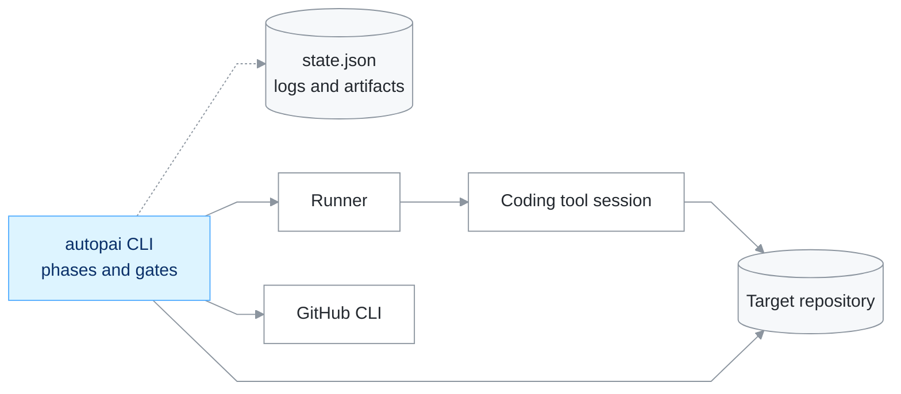
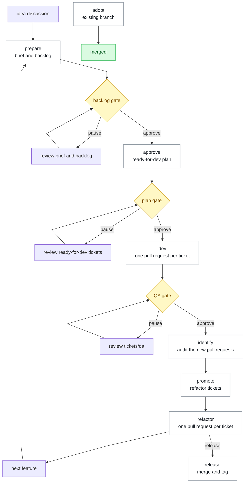

# AutopAI Manual

This manual explains how AutopAI works, who does what, and how to operate it day by day. The README covers installation and the quick start. The `spec/` folder holds the design decisions this manual describes from a user perspective.

## Table of contents

1. [What AutopAI is](#1-what-autopai-is)
2. [Core concepts](#2-core-concepts)
3. [The agents](#3-the-agents)
4. [The lifecycle](#4-the-lifecycle)
5. [Tickets](#5-tickets)
6. [Configuration](#6-configuration)
7. [CLI reference](#7-cli-reference)
8. [State, logs, and artifacts](#8-state-logs-and-artifacts)
9. [Safety and permissions](#9-safety-and-permissions)
10. [Customization](#10-customization)
11. [Extending AutopAI](#11-extending-autopai)
12. [Walkthroughs](#12-walkthroughs)
13. [Troubleshooting and FAQ](#13-troubleshooting-and-faq)
14. [Design decisions and where to read more](#14-design-decisions-and-where-to-read-more)
15. [Glossary](#15-glossary)

## 1. What AutopAI is

AutopAI is an external orchestrator. It runs as a Node CLI inside a target repository and coordinates agentic coding tools through a development lifecycle: a feature request becomes a backlog, the backlog becomes tickets, the tickets become pull requests, and the pull requests merge only after CI passes.

The division of responsibility is the key idea:

- The **orchestrator** owns state, Git writes, pull requests, CI waits, and merges. It is deterministic code, not a conversation.
- The **coding tool** owns implementation. Each phase or ticket runs in a fresh session with a core-owned prompt; the brief and backlog sessions are the exception and stay open for review until the backlog gate is resolved.
- The **executor** (an agent inside the coding tool) makes commits. It never pushes and never merges.
- **CI** is the merge authority. The orchestrator fails closed when a required check is missing or failing.

Because state lives in local files, a run survives crashes, machine restarts, and tool restarts. You can stop after any phase and continue later. By default the loop is **assisted**: it pauses after `prepare`, `approve`, and `dev` for the backlog, plan, and manual QA reviews. A pause is not an approval; `resume --approve <gate>` passes one gate, and `--auto` is the explicit full-auto override. The automatic gates (local commands, CI, and policy) always run.



## 2. Core concepts

**Orchestrator.** The `autopai` CLI. It resolves the repository, loads `autopai.json`, takes a lock, runs a phase, and releases the lock. It verifies facts (commits, diffs, gates, checks) and never trusts an agent summary.

**Phase.** One step of the lifecycle: `adopt`, `prepare`, `approve`, `dev`, `identify`, `promote`, `refactor`, `release`. Each phase can be run alone, chained with `run --from --to`, or resumed after a failure.

**Session.** One non-interactive coding tool invocation with a core-owned prompt and a JSON payload. There is one session per phase step or per ticket. The brief and backlog sessions are retained after their runs so the user can request changes in place; no long-running conversation carries the run or approves a gate.

**Runner.** The adapter between the orchestrator and the coding tool CLI. The bundled runner is `opencode`. Adding a tool means adding one runner module, never touching the core.

**Platform.** The agent, permission, and command files for a specific coding tool. The bundled platform lives under `platforms/opencode/` and is installed into the tool's global configuration.

**Agent.** A named role inside the coding tool with a prompt and a permission model. AutopAI defines four: `executor`, `planner`, `auditor`, and `operator`. See [section 3](#3-the-agents).

**Ticket.** A local Markdown work item. Tickets are never committed. The orchestrator reads ready-for-dev and ready-for-refactor tickets, turns each one into a branch and a pull request, and moves the file to the done directory after the merge.

**Local artifacts.** Tickets, briefs, findings, UX proposals, and audit evidence. They stay on disk under the configured ticket directories and are excluded from Git.

**Gates.** The checks a branch must pass before anything reaches the remote. Local gates run restore, build, test, and coverage. CI gates wait for the configured check names after the pull request exists. These automatic gates always run.

**Human gate.** A configured stop after a phase: `backlog`, `plan`, `qa`, `findings`, `promotion`, or `refactor`. `pauseAfter` selects the stops; the default is `backlog`, `plan`, and `qa`. A pause is not an approval: `resume` without `--approve <gate>` stays at the gate, and `--auto` is the explicit full-auto override. Before approving, run `status`; pass `--approve` only when the reported gate matches the gate the user approved. A failed ticket or blocker is not a gate.

**State.** `state.json` under the state directory. It stores the run mode, phase, feature, branch, SHAs, pull request number, merge commit, scopes, attempts, sessions, and blockers. Writes are atomic and a lock file prevents concurrent runs.

**Policy.** The rules that keep Git artifacts independent from local work items: branch naming, commit format, no scopes, no ticket or ADR references, no default merge message. The orchestrator enforces policy before every push and before every merge.

## 3. The agents

AutopAI runs four roles. The role names are stable; the agent names are configurable through the `agents` object in `autopai.json`. The default mapping is shown below. The executor, planner, and auditor are installed as hidden agents (`mode: all` with `hidden`), so the orchestrator can invoke them by name while only the operator agent (`autopai`) is selectable in the tool UI.

| Role | Default agent | Writes | Read-only over | Invoked by |
| --- | --- | --- | --- | --- |
| executor | `executor` | Source and tests, commits | Tickets, CI, configuration | `adopt`, `dev`, `refactor`, `release` |
| planner | `planner` | `tickets/backlog/**`, `tickets/ready-for-dev/**`, `tickets/ready-for-refactor/**`, `tickets/done/**` | Source, tests | `prepare`, `approve`, `promote` |
| auditor | `auditor` | `tickets/identified/**`, `tickets/ux/**` | Source, tests, UX | `identify` |
| operator | `autopai` | `autopai.json`, `.gitignore`, ADRs | Everything else | `/autopai-init` and manual commands |

An important clarification: `build` is a built-in agent of OpenCode, not part of AutopAI. It has no role in a run. Every AutopAI session names its agent explicitly, and the agent name comes from the configuration.

The prompts that drive each session are owned by the core and live in `src/prompts/` (`autopai-finish.md`, `autopai-dev.md`, `feature-brief.md`, `backlog.md`, `ready-for-dev.md`, `identified.md`, `ready-for-refactor.md`, `release.md`). The platform files under `platforms/opencode/agents/` only define permissions and standing rules. A port to another tool recreates the roles, not the prompts.

### 3.1 Executor (`executor`)

**Mission.** Execute exactly one work item per session and commit the result.

**Work item modes.** The prompt payload tells the executor what kind of work it is:

- `finish`: finish an adopted branch. Fix the policy violations and gate failures listed in the payload, then leave the branch green. The payload can also include `prTitlePath`; the executor writes the proposed pull request title as one line in that file.
- `title`: the branch is already green; only propose the pull request title.
- `policy-fix`: the orchestrator found Git artifact violations right before a push and asks for a focused fix.
- `dev`: implement one ready-for-dev ticket.
- `refactor`: implement one ready-for-refactor ticket with the same discipline.

**Permissions (bundled platform).** The executor may edit any file except protected paths, run any command except `git push`, `git merge`, `git rebase`, `git reset --hard`, `gh`, and destructive delete commands. It cannot ask questions, run tasks, or touch files outside the repository.

**Commits.** The executor stages only the files it changed and commits with `<type>: <subject>`, no scope parentheses, and no ticket, ADR, or issue references.

**Blocking.** The executor never asks a question. When a ticket needs a human decision, an ADR, or a change outside its scope, it writes a JSON blocker under `<stateDir>/needs-human/` and stops. The orchestrator reports the run as blocked; you resolve it and resume. An explicit dev or refactor resume moves the blockers recorded by the previous attempt into the run artifacts, so a resolved blocker does not block again; a new blocker remains active. If CI fails without a usable failure log, the orchestrator writes a CI-access blocker with the job links and does not ask the executor to fix a failure it cannot see.

### 3.2 Planner (`planner`)

**Mission.** Produce local planning artifacts. Nothing else.

**Phases.** `prepare` runs the planner twice: once for the feature brief (only when `brief.md` does not exist yet) and once for the technical backlog. `approve` runs the planner to turn the approved backlog into ready-for-dev tickets with front matter. `promote` runs the planner to turn the Identified findings of the last audit into ready-for-refactor tickets.

**Permissions.** The planner writes only inside the configured backlog, ready-for-dev, ready-for-refactor, and done directories. Source, tests, CI, ADRs, and configuration are read-only.

**Research duty.** Before writing a backlog, the planner reads official documentation for every external API, library, or service the feature may need. Every task and subtask in the backlog must link official docs or explicitly state that it is internal logic only.

### 3.3 Auditor (`auditor`)

**Mission.** Document technical debt. Never fix it.

**Phases.** `identify` resolves one or more scopes (`branch:<name>`, `pr:<number>`, `dir:<path>`), collects local evidence, and runs the auditor once per scope. The auditor writes one Markdown file per debt under `tickets/identified/<scope>/`.

**Permissions.** The auditor writes only Markdown under the identified and UX directories. Everything else is read-only. If it cannot verify a file path or line number, it omits the finding instead of guessing.

**Golden rule: zero solutions.** An Identified ticket documents what is wrong, where, and the risk. It never proposes a refactor. A separate human or planning step decides what becomes a ready-for-refactor ticket.

**No diagnostic reports.** The evidence file (compiler warnings, test output, runtime log excerpts) is input to the auditor. The tickets are the only deliverable.

### 3.4 Operator (`autopai`)

**Mission.** Maintain the repository configuration and run orchestrator commands on request.

**Initialization and reconciliation.** `/autopai-init` runs the operator agent (`autopai`). It reads `autopai.json` when it exists and runs `autopai config check --repo . --json` first; that deterministic audit reports missing defaults, unknown or deprecated fields, invalid types and paths, legacy agent names, and secret-like keys without writing. The operator then inspects the repository root, manifests, build files, test configuration, and `.github/workflows/*.yml`, and creates or reconciles the file with the real commands, branches, and check names. Safe changes (missing fields, the default `pauseAfter`, legacy agent names, and a stale branch, command, or check with an unambiguous replacement) are applied automatically. Explicit user choices (`pauseAfter`, `ticketDirs`, `stateDir`, `agents`, `models`, `protectedPaths` extras, and `runnerOptions`) are preserved. Deprecated fields are shown and confirmed before removal; unknown keys are errors and are never silently dropped. Ambiguous or destructive changes are shown and confirmed. A natural-language request can adjust a schema field; for example, "stop after promote" adds the `promotion` gate. It never guesses a language or framework, and it validates the result with `autopai config check --repo .` and `autopai status --repo .`. Permission denials are final: if the edit tool is blocked, it stops and reports; it never bypasses the restriction with shell redirection or another write path. It does not create tickets, branches, commits, or pull requests.

**Feature discussions.** A feature idea starts a conversation, not a `prepare` run. The operator discusses the problem, scope, non-goals, providers and models, parameters, persistence, UX and acceptance criteria, proposes a short feature name, and writes nothing. It generates the brief and backlog only after an explicit request or confirmation. A wish to implement the feature is not, by itself, an explicit request to generate; when the intent is unclear, the operator asks. Open questions stay in the conversation and are never written into the brief, backlog, or UX proposal. `/autopai-plan` is the same command for both stages: it discusses first and generates after the confirmation. After generation, the brief and backlog sessions remain open. A change request is applied by the operator with `autopai revise`, which continues the retained backlog session; it never re-runs `prepare`, reloads a core prompt, or asks the user to paste the change. The agent never infers approval from the original idea and never approves the backlog. The retained sessions are deleted only after a successful backlog approval.

**Permissions.** The operator agent edits only `autopai.json`, `.gitignore`, and the architecture decision records (`tickets/adr/**` or `docs/adr/**`). It can run `autopai`, `git`, and `gh` commands, but it never edits source.

**Manual commands.** The platform commands (`/autopai-plan`, `/autopai-dev`, `/autopai-identify`, `/autopai-refactor`, `/autopai-release`, `/autopai-adopt`, `/autopai-adr`, `/autopai-init`, `/autopai-status`, `/autopai-resume`, and `/autopai-run`) run through the operator agent (`autopai`). They are convenience wrappers: each one calls the CLI with fixed arguments, and they also accept natural language, which the operator agent translates into flags. The operator also runs the internal `autopai revise --message <change>` command for review changes and `autopai qa-fix --message <failure>` for a failed QA review; they are not slash commands. `/autopai-adr` records or updates a decision only; it runs `autopai status` after writing, reports the current phase, gate, blockers, and failures, and never approves a gate or starts a phase. `/autopai-init` is the other exception: it does not call the operational CLI; the operator agent reconciles `autopai.json` directly, using `autopai status` only to validate. The other commands share the same CLI entry point.

The operator does not force the selected command. If the request belongs to another phase (for example, "resolve the technical debt" under release), it stops and names the correct command; it never bumps a version for a non-release request.

## 4. The lifecycle



The order used by `run --from --to` is `prepare`, `approve`, `dev`, `identify`, `promote`, `refactor`, `release`, `adopt`. The assisted loop pauses at the gates in `pauseAfter`, which defaults to `backlog`, `plan`, and `qa`. The optional gates `findings`, `promotion`, and `refactor` pause after `identify`, `promote`, and `refactor`. A pause is not an approval: `resume` without `--approve <gate>` stays at the gate. `--auto` skips every human gate and `--pause-after` overrides the list for one run.

### 4.1 adopt

**Purpose.** Take a branch that already has commits and drive it to a green merge without changing its scope.

**Flow.**

1. Resolve the branch (`--branch` or the current branch) and the base branch (`--base` or `baseBranch`).
2. Refuse to proceed when the working tree has pending tracked changes, when the base branch does not exist on the remote, or when the branch has no commits over the base.
3. Compute the diff, the commit list, and the changed files for `origin/<base>...<branch>`.
4. Refuse adoption when the branch modifies protected paths.
5. Scan policy: branch name, commit subjects and bodies, added code lines, and the current content of changed code files. The repository-wide file scan also reports ticket or ADR references that predate the branch, because adoption must leave the touched files compliant.
6. Run the local gates (restore, build, test, coverage).
7. Run the executor: mode `finish` when there are violations or gate failures, mode `title` when the branch is already green. In both cases the executor can propose the pull request title in `<stateDir>/pr-title.txt`; only the adopt phase reads it. The file is cleared before the adopt session so a stale title never leaks into another phase. Dev and refactor use the ticket name (`<type>: <ticket name>`) and release uses `chore: release v<version>`.
8. Re-scan policy, re-run the gates, resolve the final title (`--title` override, then the executor title when valid, then a derived title), and continue with push, pull request, CI wait, fix loop, and merge.

**Dry run.** `--dry-run` stops after the scan and prints the derived title, commits, changed files, and violations. No executor, no gates, no push.

**Failure modes.** Protected path changes, remaining policy violations, gate failures, and CI failures after `maxAttempts` attempts all stop the run with an error.

### 4.2 prepare

**Purpose.** Turn an agreed feature into a reviewable brief and backlog.

**Before the phase.** The original idea is discussed with the operator first. The discussion is not a phase: it writes no state and no files. The operator asks the questions that change the plan, proposes a short feature name, summarizes the agreement, and waits. `/autopai-plan` is the same command for the discussion and for the later generation; it only runs `prepare` after an explicit request or confirmation. A feature idea alone never starts this phase.

**Flow.**

1. Resolve a concise feature slug from `--feature` or the agreed name. A description can derive it, but prefer a short explicit name over an 80-character sentence.
2. If `tickets/backlog/<feature>/brief.md` is missing and `--description` was provided, run the planner to write the brief from the agreed summary.
3. Run the planner to write `backlog.md` next to the brief.
4. Stop at the `backlog` gate.

Nothing is implemented yet. This is the human checkpoint: read the brief, edit the backlog if needed, and decide whether to continue. The next step is `autopai resume --approve backlog` or the `/autopai-resume --approve backlog` command, which runs `approve` and stops at the `plan` gate. A generic `resume` does not approve the backlog.

### 4.3 approve

**Purpose.** Convert the approved backlog into ready-for-dev tickets and stop for review.

**Flow.**

1. Require an existing backlog for the feature.
2. Run the planner to write ready-for-dev tickets with front matter under `tickets/ready-for-dev/<feature>/`.
3. Save the state as `approve/approved` and stop at the `plan` gate.

`approve` does not start the development loop. Review the generated tickets and the technical plan, then run `autopai resume --approve plan` (or `/autopai-dev`) to implement them. This is the plan checkpoint before any branch is created.

### 4.4 dev

**Purpose.** Implement every ready-for-dev ticket, one branch and one pull request per ticket.

**Flow per ticket.**

1. Order the tickets by `depends_on` and priority.
2. Create a branch from the base branch. The name is `<type>/<slug>`; a numeric suffix is added on collision.
3. Run the executor with mode `dev` and the ticket payload.
4. Verify that at least one commit exists, scan policy, and run the local gates.
5. Push, open or reuse the pull request, wait for CI, run the fix loop on failure, and merge when the required checks pass.
6. Move the ticket file to `tickets/done/<feature>/` and record the scope in the state.

**Completion.** The phase ends at `dev-complete` when every ticket merged. The manual QA checklist is at `tickets/qa/<feature>.md`. The next step is the `qa` gate: review the checklist and run `autopai resume --approve qa` (or `/autopai-identify`) to audit the new pull requests. A generic `resume` stays at the gate.

If a QA item fails, do not approve the gate. The operator runs `autopai qa-fix --repo . --message "<failure>"`. It uses the planner to write fix tickets under `tickets/ready-for-dev/<feature>/`, then starts dev again. The same gates, CI policy, and merge rules apply. When dev completes, the QA checklist is regenerated and the run returns to the `qa` gate. The command never creates a new brief or backlog and never approves QA. A provider-capacity failure is retried once after the suggested delay; other planner failures include the real error and the `planner-qa-fix.log` path.

### 4.5 identify

**Purpose.** Audit one or more scopes and produce local Identified tickets.

**Flow.**

1. Resolve each `--scope`, or `--last <n>` for the last n pull requests merged into the base branch. Without either, the scopes come from the previous run state (the pull requests of the last `dev`, `refactor`, `adopt`, or `identify` run) or from the current branch when it has commits over `origin/<base>`. The resolved feature is carried into the new state:
   - `branch:<name>` uses `origin/<base>...<branch>`, fetches first, and writes a patch file plus a changed-file list.
   - `pr:<number>` uses the pull request diff and file list from `gh`.
   - `dir:<path>` lists the code files under the directory with Git as the source of truth: tracked and untracked files, every ignore rule honored. Large trees split into bounded chunks (`auditChunkFiles`, default 40) and each chunk runs its own auditor session (no patch).
2. Refuse to continue when the working tree already has uncommitted tracked changes.
3. Run the local gates and collect runtime logs configured in `runtimeLogs` (the five most recent files per pattern).
4. Write `evidence.json` with the gate result, coverage, and log copies.
5. Run the auditor once per scope. Each run writes one file per debt under `tickets/identified/<scope>/`.
6. Apply the optional debt filters. `--classification <list>` and `--priority <list>` reach the auditor, and the orchestrator verifies every written finding against the selected values before recording it. Non-matching files stay on disk but are not promoted by this run. If nothing matches, identify succeeds with zero findings and does not fall back to older findings.
7. Verify that no tracked file changed during the run. Untracked files never block the phase.

**Dry run.** `--dry-run` resolves the scopes and reports the file counts without collecting evidence or running the auditor.

**Debt filters.** `--classification` accepts `code-smell`, `unnecessary-complexity`, `lack-of-coverage`, `outdated-library`, `architecture`, and `missing-documentation`. `--priority` accepts `urgent`, `important`, and `minor`. Both accept comma-separated or repeated values; multiple values in one flag are OR, and the two dimensions combine with AND. The filter is stored in the run state, so `resume` and the following promotion keep it. An unknown value fails before any session starts.

**Output.** Identified tickets are local. Nothing is committed, pushed, or referenced from Git. Promotion is automatic: the `promote` phase turns every matching finding into a ready-for-refactor ticket, and the refactor loop executes them. Starting identify explicitly approves the `qa` gate; review `tickets/qa/<feature>.md` first. If `findings` is in `pauseAfter`, identify stops after the audit and `resume --approve findings` continues with promotion. If `promotion` is in `pauseAfter`, review the ready-for-refactor tickets before `resume --approve promotion`.

### 4.6 promote

**Purpose.** Turn the Identified findings of the last audit into ready-for-refactor tickets.

**Flow.**

1. Resolve the `feature` (explicit, or the feature of the last run, or `tech-debt`). The feature labels the tickets and the done directory; it does not create a subdirectory in the refactor queue.
2. Collect the Identified tickets of the last `identify` run from the state. When the state does not reference them, walk `tickets/identified/**`. When the state belongs to a filtered identify, only its matching findings are considered; the phase never falls back to every file on disk just because a filtered audit found nothing.
3. Apply the same debt filters to the findings when they are supplied directly to `promote` or when the run state carries them.
4. Run the planner once per audit chunk with the `ready-for-refactor` prompt. Each session writes its tickets directly under `tickets/ready-for-refactor/` with front matter, prefixed with the chunk name so chunks never collide.
5. Refuse to continue when no Identified ticket exists and no filter is active. With an active filter that matches nothing, the phase succeeds with zero tickets and leaves older findings untouched.
6. Record every completed chunk in the state. An interrupted promotion resumes with `autopai resume`; `autopai promote --chunk <name>` processes one pending chunk without touching the rest.

Promotion is automatic: the auditor documents, the planner promotes, and every matching finding becomes a ticket. Generated tickets preserve the user-visible behavior; the UX stays frozen unless the finding documents a UX defect. If `promotion` is in `pauseAfter`, the phase stops after writing the tickets; review them and run `resume --approve promotion` before refactor.

### 4.7 refactor

**Purpose.** Execute ready-for-refactor tickets with the same gates as `dev`.

**Flow.** Identical to `dev` except the source directory is `tickets/ready-for-refactor/` and every branch is forced to the `refactor` type. Starting refactor explicitly approves the `promotion` gate after the ready-for-refactor tickets have been reviewed. It drains the queue; `--feature <slug>` limits the run to tickets whose front matter matches. `--classification` and `--priority` select only pending tickets whose debt classification and priority match; done tickets are never re-run. If no ticket matches an active filter, the phase succeeds with zero tickets and a clear message. If a selected ticket depends on a pending ticket outside the filter, the phase stops before creating a branch and lists the dependency; include it in the filter or run without the filter. Tickets move to `tickets/done/<feature>/` using their own front matter (fallback: the run feature, then `tech-debt`). Legacy `tickets/ready-for-refactor/<feature>/` subfolders are read recursively. Filters persist through `resume` for the failed-ticket retry. If `refactor` is in `pauseAfter`, the phase stops at `refactor-complete` for review before release.

### 4.8 release

**Purpose.** Prepare, merge, and tag a release.

**Flow.**

1. Require `--version` in `MAJOR.MINOR.PATCH` format.
2. Create `chore/release-v<version>` from the base branch.
3. Run the executor in release mode: update the version and the changelog.
4. Run the local gates, use `chore: release v<version>` as the title, push, open the pull request **into `releaseBranch`** (not `baseBranch`), wait for CI, run the fix loop, and merge.
5. Tag `v<version>` on the merge commit and push the tag.

**Intent guard.** Release only ships a version. The operator refuses a request that is not a release (for example, resolving technical debt) and points to the correct phase; it never bumps the version for an unrelated request.

### 4.9 run and resume

**run.** `autopai run --from <phase> --to <phase>` executes the phases in the fixed order above, inclusive. Starting a phase explicitly approves the gate before it, but not the gates after it. After a phase whose gate is in `pauseAfter`, the run stops successfully with `pausedAt` and the next phase. A phase with failed tickets also stops the run and records them in `state.failures`. The automatic gates (local commands, CI, policy) always run. `--auto` skips every human gate; `--pause-after` overrides the list for one run.

**resume.** `autopai resume` reloads `state.json` and continues where the run stopped. It resumes an interrupted phase with the stored branch, base, and feature, and it skips completed work: identify reuses its recorded scopes and finished auditors, promote skips completed chunks, and dev/refactor only see the tickets still pending. At a gate in `pauseAfter` it stops and prints the exact approval command. A generic `resume` is **not** approval: `--approve <gate>` passes that exact gate and continues to the next gate, and approving one gate does not approve the next. `--auto` skips every human gate; `--pause-after` overrides the list. It advances local non-gated phases (`identify` to `promote`, `promote` to `refactor`) and stops at a completed refactor, adopt, or release. Re-run is safe: the orchestrator reconciles with the real branch, pull request, and checks before continuing, and it reuses an already merged pull request instead of creating a new one.

A failed ticket is not a human gate. The phase stays incomplete, `state.failures` records the ticket and its branch, and resume reuses that branch instead of creating a duplicate. A branch with commits is reused even when its name has a suffix, so retries do not create endless `-4` branches. Local gates are retried once. With `continueOnFailure` true the loop continues with independent tickets and skips dependents; `resume --fix` adds one executor repair attempt with the gate logs before recording the failure. If CI fails and no failure log is available, the run stops before any executor fix and writes a CI-access blocker with the check links. A failed dev or refactor attempt archives its recorded blockers at the start of the explicit retry; a blocker written by the new attempt still stops the run. Before any `--approve`, `status` must report the same gate; otherwise the approval is refused.

## 5. Tickets

All ticket directories are configurable through `ticketDirs` and default to:

| Directory | Purpose |
| --- | --- |
| `tickets/backlog/<feature>/` | `brief.md` and `backlog.md` |
| `tickets/ready-for-dev/<feature>/` | tickets waiting for the dev loop |
| `tickets/identified/<scope>/` | audit findings |
| `tickets/ready-for-refactor/` | flat refactor queue (legacy `<feature>/` subfolders are read recursively) |
| `tickets/ux/` | UX proposals written by the UX review command |
| `tickets/qa/` | manual verification checklist collected after the dev loop |
| `tickets/done/<feature>/` | tickets whose pull request merged |

Tickets are local artifacts. Add `/tickets/` (or the configured state directory) to `.gitignore` during initialization.

### 5.1 Front matter

Every ready-for-dev and ready-for-refactor ticket starts with:

```yaml
---
id: short-unique-id
feature: feature-slug
type: feat|fix|refactor|perf|test|docs|chore
classification: code-smell|unnecessary-complexity|lack-of-coverage|outdated-library|architecture|missing-documentation
priority: urgent|important|minor
depends_on: []
---
```

The orchestrator reads this front matter, not the ticket identifiers, so Git artifacts stay free of ticket references. `id` is required; `type` defaults to `feat`; `priority` defaults to `important`; unknown priorities fall back to `important`. `classification` is optional for feature tickets and is written by the refactor planner from the Identified finding; when it is absent, the orchestrator falls back to the checked classification in the ticket body. `depends_on` accepts an inline list `[a, b]` or a YAML block list.

### 5.2 Ordering and branch naming

Tickets run in dependency order. The order is a topological sort of `depends_on`, with ties broken by priority (`urgent`, then `important`, then `minor`) and then by file name. A dependency already present in the done directory is satisfied. An unknown pending dependency or a dependency cycle stops the phase with an error before any branch is created. When a classification or priority filter is active, a pending dependency that the filter excludes also stops the phase before any branch is created; the error names both tickets so the filter can be widened.

The branch name comes from the ticket type and the file name without its numeric prefix, for example `feat/settings-panel`. When the branch already exists locally, `-2`, `-3`, and so on are appended. The refactor loop always uses the `refactor` type.

### 5.3 Reviewing and editing

- Review `backlog.md` at the `backlog` gate before running `approve`. Edit it freely; the planner reads it at that moment.
- Review the ready-for-dev tickets at the `plan` gate before running `dev`.
- Review `tickets/qa/<feature>.md` at the `qa` gate before running identify. If it fails, report the item; the operator uses `autopai qa-fix` to create fix tickets and restart dev.
- If a ticket fails, review `state.failures` and the preserved branch. Run `resume` to retry, or `resume --fix` to attempt a repair. Do not start a duplicate branch manually.
- Edit `depends_on`, `priority`, `classification`, or `type` front matter to change execution order, debt filters, or branch type.
- Promote findings automatically with the `promote` phase, which `/autopai-identify` chains after the audit. The auditor never promotes its own findings; the planner does. Manual promotion remains the fallback: copy a finding into `tickets/ready-for-refactor/` with the required front matter.
- Add `findings`, `promotion`, or `refactor` to `pauseAfter` if you want to review the audit output, the ready-for-refactor tickets, or the refactor changes.

## 6. Configuration

`autopai.json` lives at the root of the target repository. It is created or reconciled by `/autopai-init` and must never contain secrets, tokens, or personal absolute paths. String values support `${NAME}` expansion from the process environment.

### 6.1 Field reference

| Key | Type | Default | Meaning |
| --- | --- | --- | --- |
| `runner` | string | required | Session runner name. The bundled runner is `opencode`. |
| `runnerOptions` | object | `{}` | Runner settings. The OpenCode runner reads `env` for extra environment variables and `keepSessions` to retain the tool sessions after each run. |
| `protectedPaths` | string array | `.github/**`, `AGENTS.md`, `autopai.json` | Repository-relative globs the executor must never modify. |
| `baseBranch` | string | `main` | Integration branch for feature pull requests. |
| `releaseBranch` | string | `main` | Production branch for release pull requests. |
| `requiredChecks` | string array | `[]` | CI check names that must pass before merge, exactly as `gh pr checks` reports them. |
| `ignoredChecks` | string array | `[]` | Checks that may fail or stay pending without blocking the merge. |
| `restoreCommand` | string array or null | `null` | Dependency restore command, as an argument array. |
| `buildCommand` | string array or null | `null` | Build command, as an argument array. |
| `testCommand` | string array or null | `null` | Test command, as an argument array. |
| `smokeCommand` | string array or null | `null` | Optional smoke command that runs after the test command in the local gates. |
| `coverageThreshold` | number or null | `null` | Minimum line coverage between 0 and 1. Use the same value as CI. |
| `auditChunkFiles` | integer | `40` | Maximum code files per directory audit chunk. |
| `localGateRetries` | integer | `1` | Retries after a failed local gate. Use `0` to disable. |
| `continueOnFailure` | boolean | `true` | Continue with independent tickets after a ticket failure; `false` stops the loop. |
| `maxAttempts` | integer | `3` | CI fix attempts before the run stops. |
| `maxMinutes` | integer | `240` | Wall-clock budget. Reserved: accepted, not enforced yet. |
| `commandTimeoutMinutes` | integer | `30` | Timeout per local command. |
| `sessionTimeoutMinutes` | integer | `90` | Timeout per AI session. |
| `checkPollSeconds` | integer | `30` | CI polling interval. |
| `checkTimeoutMinutes` | integer | `30` | CI wait budget per check cycle. |
| `autoMerge` | boolean | `true` | Reserved: the implementation always merges after the required checks pass. |
| `approvalRequired` | boolean | `true` | Reserved and superseded by `pauseAfter`. |
| `pauseAfter` | string array | `["backlog", "plan", "qa"]` | Human gates where the assisted loop stops. An empty array disables human pauses. |
| `prTitle` | string or null | `null` | Null lets the executor decide the title. |
| `runtimeLogs` | string array | `[]` | Local runtime log globs used as audit evidence. |
| `commitTypes` | string array | `feat`, `fix`, `refactor`, `perf`, `test`, `docs`, `chore` | Allowed commit and pull request types. |
| `agents` | object | see below | Agent name per role. |
| `models` | object | all null | Optional model override per role. |
| `ticketDirs` | object | see [section 5](#5-tickets) | Ticket directory paths. |
| `stateDir` | string | `tickets/.autopai` when `tickets/` exists, else `.autopai` | Local state directory. |

Default `agents` object:

```json
{
  "agents": {
    "executor": "executor",
    "planner": "planner",
    "auditor": "auditor",
    "operator": "autopai"
  }
}
```

### 6.2 Pause gates

`pauseAfter` selects where the assisted loop stops for a human review. It defaults to the three professional gates:

```json
"pauseAfter": ["backlog", "plan", "qa"]
```

| Gate | Stops after | Review |
| --- | --- | --- |
| `backlog` | `prepare` | brief and backlog |
| `plan` | `approve` | ready-for-dev tickets |
| `qa` | `dev` | `tickets/qa/<feature>.md` |
| `findings` | `identify` | audit findings |
| `promotion` | `promote` | ready-for-refactor tickets |
| `refactor` | `refactor` | refactor changes before release |

An empty array disables every human pause. Listing all six pauses after every phase. The automatic gates (local commands, CI, and policy) always run; `pauseAfter` only controls the human stops. `--auto` skips every human gate for one run, and `--pause-after` overrides the list for one run.

A pause is not an approval. `resume` without `--approve <gate>` stays at the gate and prints the exact approval command. `--approve <gate>` passes that gate only and stops at the next configured gate.

To change the gates, rerun `/autopai-init` with a natural-language request (for example, "stop after promote" or "only stop at the plan"). The operator applies the adjustment, preserves the other fields, and validates the file. The gate names are stable; the request does not need to match a fixed phrase. Adding a gate is safe. Removing or replacing gates is destructive: the operator shows the proposed list and asks for confirmation before writing, even when the request uses "only".

### 6.3 Example

```json
{
  "runner": "opencode",
  "baseBranch": "develop",
  "releaseBranch": "main",
  "requiredChecks": ["Build and test"],
  "ignoredChecks": [],
  "restoreCommand": ["npm", "ci"],
  "buildCommand": ["npm", "run", "build"],
  "testCommand": ["npm", "test", "--", "--coverage"],
  "coverageThreshold": 0.7,
  "pauseAfter": ["backlog", "plan", "qa"],
  "localGateRetries": 1,
  "continueOnFailure": true,
  "maxAttempts": 3,
  "ticketDirs": {
    "backlog": "tickets/backlog",
    "readyForDev": "tickets/ready-for-dev",
    "identified": "tickets/identified",
    "readyForRefactor": "tickets/ready-for-refactor",
    "ux": "tickets/ux",
    "done": "tickets/done"
  },
  "stateDir": "tickets/.autopai"
}
```

### 6.4 Validation

`autopai config check --repo .` is the deterministic schema audit. It is read-only and reports:

- Missing optional fields with their effective defaults, so `/autopai-init` can fill them.
- Unknown top-level or nested keys.
- Deprecated fields (`autoMerge` and `approvalRequired`).
- Invalid types, enums, paths, commands, and pause gates.
- Legacy agent names (`setup` or the old `autopai` executor mapping).
- Secret-like keys and personal absolute paths.
- Checks that are both required and ignored.

Use `--json` for the machine-readable report and `--strict` to fail on warnings and missing defaults. It exits 1 on errors. `/autopai-init` runs this audit before reconciling and re-runs it after writing.

The schema audit does not need the repository. `/autopai-init` still inspects the repository and CI to detect a stale branch, command, or check name that is valid JSON but no longer matches the project.

`autopai status --repo .` then loads the configuration and fails with a specific message when:

- `autopai.json` is missing.
- `runner` is missing or empty.
- `baseBranch` or `releaseBranch` is missing.
- A command is present but is not an array of strings.
- `maxAttempts` is not greater than zero.
- `localGateRetries` is not a non-negative integer or `continueOnFailure` is not a boolean.
- `pauseAfter` contains an unknown gate.

Commands are argument arrays, never shell strings, so no shell quoting or injection applies.

## 7. CLI reference

```
autopai help
autopai adopt --repo <path> [--branch <name>] [--base <branch>] [--title <title>] [--dry-run]
autopai identify --repo <path> [--last <n>] [--scope branch:<name>] [--scope pr:<number>] [--scope dir:<path>] [--classification <list>] [--priority <list>] [--dry-run]
autopai promote --repo <path> [--feature <slug>] [--chunk <name>] [--classification <list>] [--priority <list>]
autopai prepare --repo <path> [--feature <slug>] [--description <text>]
autopai approve --repo <path> [--feature <slug>]
autopai dev --repo <path> [--feature <slug>]
autopai refactor --repo <path> [--feature <slug>] [--classification <list>] [--priority <list>]
autopai release --repo <path> --version <x.y.z>
autopai run --repo <path> --from <phase> --to <phase> [--auto] [--pause-after <gates>] [--fix] [--classification <list>] [--priority <list>] [phase options]
autopai status --repo <path>
autopai config check --repo <path> [--json] [--strict]
autopai resume --repo <path> [--approve <gate>] [--auto] [--pause-after <gates>] [--fix]
autopai abort --repo <path>
```

**Config check.** `autopai config check --repo <path>` audits `autopai.json` against the schema without writing. `--json` prints the machine-readable report; `--strict` exits 1 on warnings and missing defaults. It is the audit `/autopai-init` uses before reconciling a configuration.

**Global flags.** `--repo <path>` selects the target repository and defaults to the current directory. Flags accept `--flag value` and `--flag=value`. `--scope`, `--classification`, and `--priority` can be repeated; the debt filters also accept comma-separated lists.

**Debt filters.** `--classification` accepts `code-smell`, `unnecessary-complexity`, `lack-of-coverage`, `outdated-library`, `architecture`, and `missing-documentation`. `--priority` accepts `urgent`, `important`, and `minor`. Values in one flag are OR; the two flags combine with AND. They apply to `identify`, `promote`, and `refactor`, never to `--feature`. The identify filter reaches the auditor and the promotion; the refactor filter selects only pending tickets. The run state stores the filters so `resume` keeps them; a new refactor command without filters drains the queue.

**Human gate flags.** `--approve <gate>` passes one gate and continues to the next configured gate. `--auto` skips every human gate. `--pause-after <gates>` overrides `pauseAfter` for one run; the value is a comma-separated gate list or an empty string to disable every human pause. These flags never disable the automatic gates.

**Failure flags.** `--fix` runs one executor repair attempt on a failed ticket branch with the local gate logs, then retries the gates. It never bypasses the automatic gates or approves a human gate.

**Defaults.** `--feature` resolves from the previous run state or the latest ticket directory, and `--scope` defaults to the scopes of the last run. Explicit flags always win, and the resolver fails with a clear error instead of guessing when no candidate exists.

**Output.** Successful commands print a JSON result to standard output, except `status`, `abort`, and `config check`, which print short human-readable text by default. `config check --json` prints the full report. Errors go to standard error prefixed with `autopai: ` and the process exits with code 1. `config check` exits 1 on schema errors; `--strict` also exits 1 on warnings and missing defaults.

**Locking.** Commands that run a phase take `run.lock` under the state directory. A second concurrent run fails with the active pid. `status`, `config check`, and `help` never lock.

**status output.**

```json
{
  "runId": "20261018010532-12345",
  "mode": "dev",
  "phase": "dev-complete",
  "feature": "settings-panel",
  "branch": null,
  "prNumber": null,
  "mergeCommit": null,
  "scopes": 0,
  "completedPhases": [],
  "failures": [],
  "filters": { "classifications": [], "priorities": [] },
  "gate": "qa",
  "paused": true,
  "pauseAfter": ["backlog", "plan", "qa"]
}
```

When no state exists, `status` prints `No AutopAI state found for this repository.` The `gate` is the current human checkpoint (`null` when the run is mid-phase), and `paused` tells whether that gate is in `pauseAfter`. `failures` lists the failed or blocked tickets with their branches and stages. `status` is always read-only.

## 8. State, logs, and artifacts

Everything runtime-related lives under the state directory. Nothing here is committed.

```
tickets/.autopai/
├── state.json              current run state
├── run.lock                present only while a run is active
├── pr-title.txt            executor-proposed title for the adopted branch (cleared before the adopt session)
├── needs-human/            blocker JSON files written by the executor
├── artifacts/<runId>/
│   ├── branch.patch
│   ├── commits.txt
│   ├── changed-files.txt
│   ├── policy-latest.json
│   ├── policy-final.json
│   ├── checks-latest.json
│   ├── ci-failure-<n>.log
│   ├── gate-<name>.log, initial-*.log, final-*.log, fix-<n>-*.log
│   ├── executor-*.log, planner-*.log, auditor-*.log, refactor-*.log, release-*.log
│   ├── *.prompt.md         copy of the rendered prompt sent to each session
│   └── runtime-logs/
└── logs/<runId>.jsonl      event log for the run
```

**Tool sessions.** The OpenCode runner normally deletes the non-interactive session it creates after each run; the transcript stays in the artifacts. The brief and backlog sessions are retained after `prepare`, recorded in `state.sessions`, and shown by `status` and the `prepare` result. Review changes are applied with `autopai revise`, which sends the raw user request to the retained backlog session through `opencode run --session`; the original prompt stays in that conversation and is never loaded or injected again. After a successful backlog approval, both retained sessions are deleted. If approval fails, or a session cannot be deleted, they stay available for review. An interrupted prepare with both files is reconnected by `status` or `resume`; the state moves to `awaiting_approval` without running a prompt or approving. The title carries a random per-run token and only an unambiguous match is deleted, so sessions you create yourself are never touched. The operator conversation is not a planner session and is never deleted by AutopAI. Set `runnerOptions.keepSessions` to true to keep every session in the tool history; that also opts out of the prepare-session cleanup.

**state.json fields.** `schemaVersion`, `runId`, `mode`, `phase`, `completedPhases`, `repo`, `feature`, `branch`, `baseBranch`, `releaseBranch`, `baseSha`, `headSha`, `prNumber`, `prTitle`, `mergeCommit`, `scopes`, `filters`, `changedFiles`, `attempts`, `sessions`, `blockers`, `createdAt`, `updatedAt`. `filters` holds the canonical `classifications` and `priorities` arrays of the current run. `sessions` holds the retained prepare review conversations with `kind`, `feature`, `title`, `id`, and `createdAt`; the orchestrator records them before it stops at the backlog gate and clears them after a successful approval.

**Reconciliation.** On resume, the orchestrator checks the real branch, commits, pull request state, and checks before continuing. An already merged pull request is reused, and the run records the existing merge commit.

**Blockers.** When the executor cannot continue, it writes a JSON file under `needs-human/` with the reason, the files involved, and what a human must decide. The orchestrator checks that folder after every executor session: when a blocker exists, the phase stops immediately with the blocker path and records it in the state, so partial work never reaches a pull request. Resolve the issue — architecture decisions go through `/autopai-adr` in the interactive coding tool — and run `autopai resume`.

**abort.** Marks `state.json` as `aborted` and releases the lock without touching the repository or the remote.

## 9. Safety and permissions

### 9.1 Executor restrictions

The executor can edit source and tests and can commit. It cannot push, fetch new branches, merge, rebase, force-push, run `gh`, or delete files destructively. It cannot edit tickets, ADRs, `.github/**`, `AGENTS.md`, `opencode.json*`, or `autopai.json`. The orchestrator re-verifies the diff before every push regardless of what the agent reported.

### 9.2 Protected paths

`protectedPaths` is a list of repository-relative globs. Adoption refuses a branch that modifies them. Every push re-checks the changed files against the list. The bundled platform also denies those paths at the tool level, so violations normally never reach the diff.

### 9.3 Policy verification

Before any push and before any merge, the orchestrator validates:

- **Branch name.** `<type>/<kebab-case-slug>` with allowed types. No numeric segments that look like ticket identifiers, no `ticket` or `#` references, no ADR references.
- **Commit subjects and bodies.** `<type>: <subject>`, no scope parentheses, no ticket paths, no `TICKET-123`, no `ADR-000`, no `#123` issue references, no GitHub default merge subject.
- **Added code lines.** No ticket paths, no ADR references. Issue-style `#123` is only checked in commit and pull request text because color literals such as `#0AFFFFFF` are valid in styles.
- **Repository files.** Changed code files are scanned again in full, so references that predate the branch are caught when the branch touches the file.
- **Pull request title and body.** Same subject rules, no references of any kind.

When violations appear during a push, the orchestrator asks the executor for a focused `policy-fix` session and re-verifies. If violations remain, the run stops.

### 9.4 Local gates

Local gates run before every push, in order: `restoreCommand`, `buildCommand`, `testCommand`, `smokeCommand` when configured, then coverage. Coverage is read from Cobertura reports found under `TestResults/**/coverage.cobertura.xml`, summed across reports, and compared with `coverageThreshold` when set. A missing report fails the gate when a threshold is configured. Each command runs with `commandTimeoutMinutes` and its output is saved under the run artifacts.

### 9.5 CI gates

After the pull request exists, the orchestrator polls `gh pr checks` every `checkPollSeconds` up to `checkTimeoutMinutes`:

- A failed, cancelled, timed-out, or action-required check on a non-ignored check fails immediately.
- Required checks must appear within 120 seconds and must finish in `SUCCESS`.
- When no required checks are configured, every non-ignored check must finish in `SUCCESS`, `SKIPPED`, or `NEUTRAL`.
- `ignoredChecks` are excluded from all of the above.

The reported checks are stored as `checks-latest.json` artifacts on every poll.

### 9.6 Fix loop

On CI failure, the orchestrator collects the failed logs (`ci-failure-<n>.log`, truncated for the prompt), sends them to the executor with the attempt number, re-validates policy, re-runs the local gates, pushes, and waits again. The loop runs up to `maxAttempts` times. When the attempt budget is exhausted, the run stops with an error.

### 9.7 Merge rules

- A merge happens only after every required check passes.
- A conflicting pull request stops the run. A pull request that is `BEHIND` gets its branch updated and the checks are awaited again.
- The merge commit subject is the pull request title, and the body states the branch, the base, and the CI result, including coverage. The generated body never references tickets, ADRs, or issues.
- After the merge, the orchestrator verifies the pull request state is `MERGED` and deletes the remote branch. It also prunes remote refs, fast-forwards the local base branch, returns to it, and deletes the merged local branch. Local divergences are reported and never overwritten.

## 10. Customization

**Models per role.** Set `models.executor`, `models.planner`, `models.auditor`, or `models.operator` to a model string accepted by the runner. The OpenCode runner passes it with `--model`. Null means the tool default.

**Agent names per role.** Set `agents.executor` and the rest when you define your own agent files. The orchestrator passes the configured name to the runner.

**Runner environment.** `runnerOptions.env` adds environment variables to every session. The OpenCode runner always sets `OPENCODE_DISABLE_AUTOUPDATE=1`.

**Timeouts and attempts.** `commandTimeoutMinutes`, `sessionTimeoutMinutes`, `checkPollSeconds`, `checkTimeoutMinutes`, and `maxAttempts` tune the run without touching code.

**Coverage.** `coverageThreshold` expects a Cobertura report from the test command. Keep the value identical to the CI threshold so local gates and CI agree.

**Ticket and state paths.** `ticketDirs` and `stateDir` are configurable, but the bundled platform agents hard-code permission rules for the default paths (`tickets/**`, `tickets/.autopai/**`). If you change them, update the agent permission rules under `platforms/opencode/agents/` accordingly. The executor needs write access to `<stateDir>/pr-title.txt` and `<stateDir>/needs-human/**` in particular.

## 11. Extending AutopAI

### 11.1 Adding a coding tool runner

1. Create `src/runners/<name>.js` exporting `runSession({ config, agent, promptText, title, logFile, role })`.
2. Register the module in the runner map at `src/runners/index.js`.
3. Set `"runner": "<name>"` in every repository that uses it.

Keep the prompt text passed in by the orchestrator. The runner only maps the call to the tool CLI and handles timeout, logging, and environment.

### 11.2 Adding a platform

1. Recreate the four roles with the tool's agent, skill, or system-prompt mechanism.
2. Recreate the protected-path and Git-write restrictions with the tool permission model. When the tool has none, rely on the orchestrator diff verification.
3. Confirm the tool accepts a prompt supplied at session start. It must not require prompts registered inside the tool.
4. Provide command wrappers if the tool supports them, mirroring `platforms/opencode/commands/`.
5. Run the verification checklist in `BOOTSTRAP_PROMPT.md` before trusting the port.

`spec/PLATFORMS.md` is the authoritative guide for both cases.

### 11.3 Adding a phase

A phase is a function in `src/phases/` that receives `{ config, stateStore, options, log }`, writes state, and returns a JSON result. Register it in the command dispatch in `src/cli.js` and in the `PHASES` order array. Keep prompts in `src/prompts/` and keep Git writes in the orchestrator, never in a prompt.

## 12. Walkthroughs

The examples use a generic Node repository with `npm ci`, `npm test`, CI check `build`, base branch `develop`, and release branch `main`.

### 12.1 Walkthrough: adopt an existing branch

An existing feature branch `feat/order-history` has four commits and no push yet.

1. Make sure the working tree is clean and `gh auth status` succeeds.
2. Preview the adoption:

```
autopai adopt --repo . --branch feat/order-history --dry-run
```

Read the output: derived title, commit list, changed files, and any policy violations. In this example, the scan finds an `ADR-012` reference in one of the changed source files.

3. Run the adoption for real:

```
autopai adopt --repo . --branch feat/order-history
```

The orchestrator scans policy, runs the gates, runs the executor in `finish` mode (it removes the ADR reference and fixes anything else the payload lists), re-scans, re-runs the gates, and proposes the title `feat: order history`. It then pushes the branch, opens the pull request, waits for the `build` check, and merges with the pull request title as the merge subject.

4. Inspect the result. The output contains the pull request number, the merge commit, the commits, the changed files, and the coverage.

If the branch already passes everything, the executor only proposes the title.

### 12.2 Walkthrough: a full feature cycle

The feature is a settings panel for a web application.

1. Prepare:

```
autopai run --repo . --from prepare --to prepare --feature settings-panel --description "Add a settings panel with theme and language options"
```

The planner writes `tickets/backlog/settings-panel/brief.md` and `backlog.md`. The phase stops at the `backlog` gate.

2. Review the brief and the backlog. Fix any wrong assumption, reorder tasks, or clarify external API links. This is the cheapest moment to change direction.

3. Approve the backlog and generate the plan:

```
autopai resume --repo . --approve backlog
```

The planner generates ready-for-dev tickets with front matter and the run stops at the `plan` gate. Review the technical plan in `tickets/ready-for-dev/settings-panel/`.

4. Implement the plan:

```
autopai resume --repo . --approve plan
```

The dev loop takes each ticket, creates its branch, runs the executor, verifies policy and gates, opens the pull request, waits for CI, merges, and moves the ticket to `tickets/done/settings-panel/`. Every merged pull request updates the state with its number and merge commit. The run stops at the `qa` gate.

5. Review `tickets/qa/settings-panel.md`. If the behavior is correct, continue:

```
autopai resume --repo . --approve qa
```

The audit runs against the pull requests of the last run, promotes the findings, and refactors the new debt. Add `promotion` to `pauseAfter` if you want to review the ready-for-refactor tickets before that phase.

6. Check progress at any time:

```
autopai status --repo .
```

If CI fails, the orchestrator automatically runs up to `maxAttempts` executor fix attempts before stopping. If the run stops, fix the reported blocker and continue with `autopai resume --repo .`.

### 12.3 Walkthrough: identify, refactor, release

1. Audit the merged work. Starting identify explicitly approves the `qa` gate, so review `tickets/qa/` first:

```
autopai identify --repo . --scope branch:feat/order-history --scope pr:412
```

The auditor writes one Identified ticket per debt under `tickets/identified/feat-order-history/` and `tickets/identified/pr-412/`. Nothing is committed.

2. Promote. `/autopai-identify` already chained `promote`, so every finding became a ready-for-refactor ticket under `tickets/ready-for-refactor/` with the `settings-panel` feature in its front matter. To run it alone, use `autopai promote --repo . --feature settings-panel`. The auditor never promotes its own findings; the planner does. If `promotion` is in `pauseAfter`, review the tickets and run `autopai resume --repo . --approve promotion`.

3. Refactor:

```
autopai run --repo . --from refactor --to refactor --feature settings-panel
```

Each refactor ticket becomes a `refactor/<slug>` branch through the same gates and merge rules.

To restrict the debt, add the filters to identify or refactor:

```
autopai identify --repo . --last 3 --classification code-smell --priority urgent
autopai refactor --repo . --classification missing-documentation --priority minor
```

The first command audits only the last three merged pull requests and records only urgent code smells. The second refactors only pending missing-documentation tickets with minor priority. Done tickets are not re-run. If the filter excludes a pending dependency, the refactor stops and lists it instead of silently skipping the work.

4. Release:

```
autopai run --repo . --from release --to release --version 1.4.0
```

The executor updates the version and changelog on `chore/release-v1.4.0`, the orchestrator opens the pull request into `main`, waits for CI, merges, tags `v1.4.0`, and pushes the tag.

### 12.4 Walkthrough: blocked on an architecture decision

A dev ticket needs a new pattern the repository has not decided yet.

1. The executor reads the ticket and the repository ADRs, cannot find a decision, writes a blocker under `tickets/.autopai/needs-human/`, and stops.
2. The orchestrator detects the blocker after the session, records it in the state, and stops the phase with the blocker path. Nothing was pushed.
3. Read the blocker, then run `/autopai-adr` in the interactive coding tool with the context ("record the decision for the blocked ticket"). The operator agent analyzes the options, you confirm the chosen path, and it writes the ADR to the repository ADR directory.
4. Run `autopai resume`. The executor now finds the ADR, implements the ticket, and the loop continues with push, pull request, CI, and merge.

## 13. Troubleshooting and FAQ

**`Missing autopai.json at <path>. Run /autopai-init first.`** The target repository has no configuration. Run `/autopai-init` in the coding tool, or write `autopai.json` manually and validate with `autopai status --repo .`.

**`Another AutopAI run is active with pid <n>.`** A lock from a live process exists. If the process is gone, the lock is stale and any next run replaces it. If it is alive, wait or run `autopai abort --repo .` to mark the run aborted and release the lock.

**`Unknown runner` or runner errors during a session.** The `runner` value does not match a module under `src/runners/`. Use `opencode` or add the runner first.

**`Cannot switch from <a> to <b>: the working tree has pending tracked changes.`** Adoption needs a clean tree. Commit or stash tracked changes. `autopai.json`, `tickets/`, and `.autopai/` are allowed as untracked files.

**`The branch changes protected paths and cannot be adopted automatically.`** The branch modifies a path listed in `protectedPaths`. Review the change manually. If the path is legitimately part of the feature, adjust `protectedPaths` in `autopai.json` first; remember that the bundled executor cannot edit that file.

**`Policy violations remain after the executor run.`** The executor could not remove a violation. The message lists file and line. Fix it manually, amend the commit if needed, and resume or re-run adopt.

**`Coverage X% is below the configured minimum Y%.`** The Cobertura report under `TestResults/` is below `coverageThreshold`. Add tests or align the threshold with CI.

**`No audit scope could be resolved.`** `identify` found no explicit `--scope`, no state from a previous run, and the current branch has no commits over the base. Pass `--scope branch:<name>` or `--scope pr:<number>`.

**`No Identified tickets were found.`** `promote` ran without findings. Run `identify` first, or generate the Identified tickets manually under `tickets/identified/`.

**`Unknown classification: <value>` or `Unknown priority: <value>`.** The debt filter uses a value outside the supported list. Use `code-smell`, `unnecessary-complexity`, `lack-of-coverage`, `outdated-library`, `architecture`, or `missing-documentation`; priorities are `urgent`, `important`, and `minor`.

**`No ready-for-refactor tickets match ...`** The filter is valid but no pending ticket matches it. The command intentionally does not drain the rest of the queue. Widen the filter or run without classification and priority.

**`The filter excludes pending dependencies required by the selected tickets: ...`** A selected ticket depends on another pending ticket that the filter excluded. Include the dependency in the filter or remove the filter; done dependencies are already satisfied.

**`The executor is blocked:`** The executor wrote one or more JSON files under `needs-human/` and the phase stopped before any push. Read them, resolve the decision (architecture decisions: run `/autopai-adr` in the interactive coding tool), and run `autopai resume`.

**A promotion stopped mid-way.** The state records every completed chunk. Run `autopai resume`, or `autopai promote --repo . --feature <feature> --chunk <name>` for one pending chunk without redoing the rest.

**`The working tree has uncommitted tracked changes.`** `identify` only audits a clean tracked tree. Commit or stash the changes before retrying. Untracked files such as an uncommitted `autopai.json` never block the phase.

**`Could not resolve --feature: no ticket directory was found.`** The previous state and the ticket directories offered no candidate. Pass `--feature <slug>` explicitly or create the backlog first.

**`Required checks were not reported: <names>.`** Within 120 seconds of the first poll, `gh pr checks` did not report every name in `requiredChecks`. Confirm the exact names with `gh pr checks <number>` and copy them verbatim.

**`CI did not pass after <n> attempts.`** The fix budget is exhausted. Read the `ci-failure-<n>.log` artifacts, fix locally, push, and resume.

**`Executor failed with exit code <n>.`** Read the corresponding `executor-*.log` artifact. Common causes are missing build tools, a command timeout, or a blocker written under `needs-human/`.

**Resume prints a message instead of running.** That is a human gate or a mode that does not resume automatically. At a gate, review the artifacts and approve that exact gate: `autopai resume --approve backlog`, `--approve plan`, `--approve qa`, `--approve findings`, `--approve promotion`, or `--approve refactor`. A generic `resume` never approves a gate. Completed refactors and adopted merges also stop; start the next step explicitly.

**A ticket failed local gates.** The branch is preserved and the state records the failure; the loop continues with independent tickets by default. Run `autopai resume` to retry the failed branch, or `autopai resume --fix` to give the executor one repair attempt with the gate logs. Do not create a manual duplicate branch.

**The operator started a release for a technical-debt request.** It should not. The release command now refuses a non-release request and points to `/autopai-refactor` or `/autopai-resume`; a release requires a version or an explicit release intent.

**The run stopped but `status` shows an old phase.** `status` shows the last saved state. Failed runs keep the phase they were in. The error output is the source of truth for why it stopped.

**How do I change a pause gate?** Run `/autopai-init "stop after promote"` or describe the change in your own words. The operator adjusts `pauseAfter`, preserves the rest of the configuration, and validates with `status`. Adding a gate is safe. "Only stop at X" proposes a list with that gate and confirms before replacing the current one.

**How do I discuss a feature before generating the brief?** Start with a plain message or `/autopai-plan "<idea>"`. The operator discusses and writes nothing. When you are ready, ask it to generate the brief and backlog; `/autopai-plan` then runs `prepare`. It never generates from the idea alone and never approves the backlog.

**How do I refresh an outdated autopai.json?** Run `/autopai-init` with no message. It runs `autopai config check`, applies safe corrections, preserves your explicit choices, and asks before an ambiguous or destructive change. To inspect first without writing, run `autopai config check --repo .`; add `--json` for the full report or `--strict` to fail on warnings and missing defaults.

**Where do I see what the agents did?** Every session writes a log under `<stateDir>/artifacts/<runId>/`, and the event stream is in `<stateDir>/logs/<runId>.jsonl`. During a backlog review, `autopai status` also lists the retained brief and backlog session titles and ids. The `prepare` result includes `plannerMessages`, and `autopai revise` returns the planner output, so open questions are relayed in the chat instead of the artifacts.

## 14. Design decisions and where to read more

The `spec/` folder records the decisions this manual operates. Read them in this order:

- `spec/ARCHITECTURE.md`: the division of responsibility, design rules, phase list, state model, gates, protected paths, and the policy verification summary.
- `spec/POLICIES.md`: the Git artifact policy, local artifact policy, per-role permissions, quality rules, and security rules.
- `spec/CONFIG_SCHEMA.md`: the configuration schema, generation rules, and reconciliation rules the operator agent follows.
- `spec/PLATFORMS.md`: the runner interface, the bundled platform, and the porting checklist.
- `AGENTS.md`: the repository-wide engineering rules, including the Git and CI/CD rules every agent follows.

Decisions worth highlighting:

- **Git-host dependency.** GitHub is a hard dependency today because pull requests, checks, and merges go through `gh`. The coding tool is replaceable through runners; the Git host would need its own adapter layer.
- **English-only artifacts.** Prompts and generated artifacts are always English. There is no language detection.
- **Issue-reference check scope.** `#123` references are checked in commit and pull request text only, because color literals such as `#0AFFFFFF` are valid in styles.
- **Fail closed.** A missing required check stops the run instead of guessing that a check was renamed.

## 15. Glossary

**Adopt.** Phase that finishes an existing branch through push, pull request, CI, and merge.

**Agent.** A named role in the coding tool with a prompt and permissions. AutopAI defines `executor`, `planner`, `auditor`, and `operator`.

**Artifacts.** Per-run files under `<stateDir>/artifacts/<runId>/`: patches, commit lists, gate logs, check snapshots, and session logs.

**Blocker.** A JSON file under `<stateDir>/needs-human/` written by the executor when a human decision is required. The run stops until you resolve it.

**Brief.** `brief.md` under the backlog directory. The agreed scope written before the backlog.

**Cobertura.** The XML coverage format the orchestrator reads from `TestResults/**/coverage.cobertura.xml`.

**Executor.** The role that implements work items and commits. Default agent name: `executor`.

**Gate.** An automatic check (local commands or CI) that blocks a push or merge, or a configured human stop. The automatic gates always run; human gates come from `pauseAfter`.

**Human gate.** A configured pause after a phase (`backlog`, `plan`, `qa`, `findings`, `promotion`, or `refactor`). A pause is not approval: `resume --approve <gate>` passes one gate.

**Identified ticket.** A local audit finding under `tickets/identified/`. Documentation only, no solutions.

**Local artifact.** Anything that must never be committed: tickets, briefs, findings, proposals, and evidence.

**Lock.** `<stateDir>/run.lock`. Prevents two concurrent runs.

**Phase.** One lifecycle step: `adopt`, `prepare`, `approve`, `dev`, `identify`, `refactor`, `release`.

**Platform.** Agent, permission, and command files for one coding tool, under `platforms/<tool>/`.

**Policy.** The Git artifact and quality rules enforced by the orchestrator before every push and merge.

**Promote.** Phase that turns the Identified findings of the last audit into ready-for-refactor tickets through the planner.

**Protected path.** A repository-relative glob the executor must never modify.

**Runner.** The module that maps `runSession` to a coding tool CLI.

**Scope.** An audit target: `branch:<name>`, `pr:<number>`, or `dir:<path>`.

**Session.** One non-interactive coding tool invocation with a core-owned prompt.

**State directory.** `<stateDir>`, default `tickets/.autopai`. Holds `state.json`, the lock, artifacts, logs, and blockers.

**Ticket.** A local Markdown work item with front matter. Ready-for-dev and ready-for-refactor tickets drive the loops.
